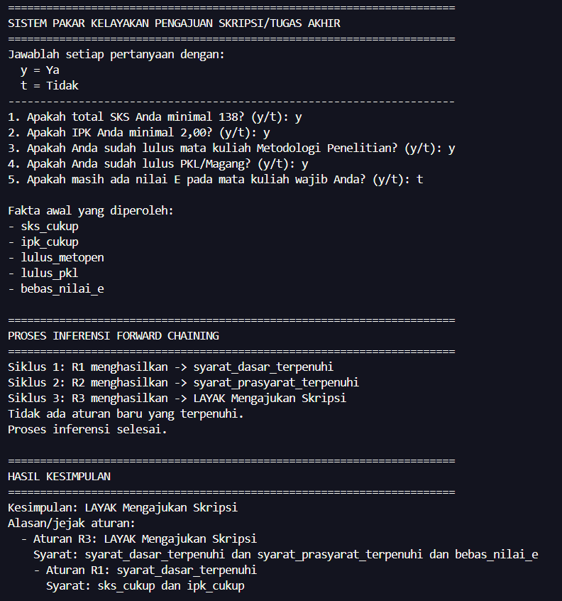
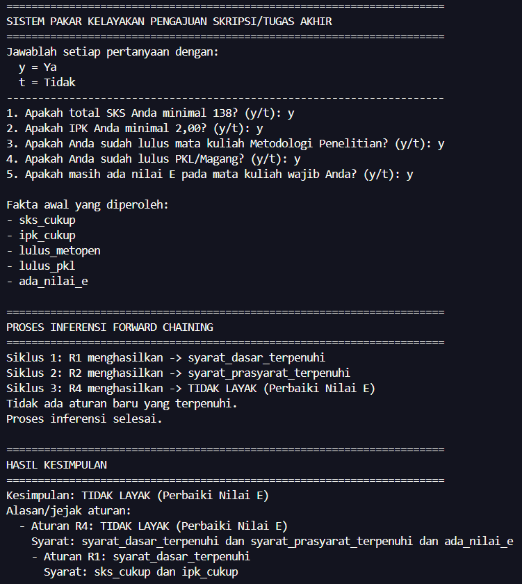
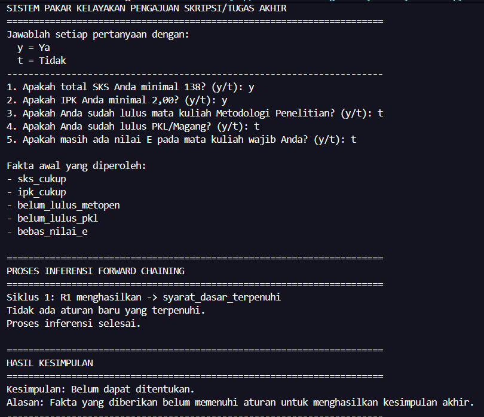

# SISTEM PAKAR KELAYAKAN PENGAJUAN SKRIPSI/TUGAS AKHIR

## 1. Nama dan NIM

- **Nama:** Iqbal Mauluddin
- **NIM:** F1D02510011
- **Mata Kuliah:** Kecerdasan Buatan
- **Program Studi:** Teknik Informatika
- **Universitas:** Universitas Mataram

## 2. Topik dan Cara Menjalankan Program

### Topik

**Sistem Pakar Kelayakan Pengajuan Skripsi/Tugas Akhir**

Program ini merupakan sistem pakar sederhana untuk membantu mahasiswa melakukan pengecekan awal terhadap beberapa kriteria akademik sebelum mengajukan Skripsi/Tugas Akhir. Kriteria yang digunakan dalam model ini meliputi jumlah SKS, IPK, kelulusan mata kuliah Metodologi Penelitian, kelulusan PKL/Magang, dan keberadaan nilai E pada mata kuliah wajib.

Sistem menghasilkan tiga kemungkinan kesimpulan:

1. **LAYAK Mengajukan Skripsi:** syarat dasar, mata kuliah prasyarat, dan kondisi bebas nilai E terpenuhi.
2. **TIDAK LAYAK (Perbaiki Nilai E):** syarat dasar dan mata kuliah prasyarat terpenuhi, tetapi masih terdapat nilai E pada mata kuliah wajib.
3. **TIDAK LAYAK (SKS atau IPK Kurang):** jumlah SKS atau IPK belum memenuhi batas yang digunakan dalam model.

Jika tidak ada aturan kesimpulan yang terpenuhi, program menyampaikan bahwa belum ada keputusan akhir yang dapat diambil.

### Bahasa dan Versi

- Bahasa pemrograman: Python 3
- Format basis pengetahuan: JSON
- Metode inferensi: Forward Chaining
- Library tambahan: Tidak memerlukan library eksternal.

### Struktur File

```text
sistem-pakar-skripsi/
├── main.py
├── aturan.json
├── README.md
└── screenshot/
    ├── Kasus1.png
    ├── Kasus2.png
    └── Kasus3.png
```

- `main.py`: program utama, pengumpulan fakta, mesin inferensi, dan penampilan hasil serta alasan.
- `aturan.json`: daftar pertanyaan, sumber, aturan IF-THEN, dan kesimpulan akhir.
- `screenshot/`: tempat menyimpan tangkapan layar tiga kasus pengujian.

### Cara Menjalankan Program

1. Pastikan Python 3 sudah terpasang.
2. Simpan `main.py` dan `aturan.json` di dalam folder yang sama.
3. Buka folder tersebut menggunakan Visual Studio Code.
4. Buka terminal pada folder program.
5. Jalankan:

```bash
python main.py
```

Jika perintah tersebut tidak tersedia, coba:

```bash
py main.py
```

6. Jawab lima pertanyaan yang ditampilkan.
7. Masukkan `y` untuk Ya dan `t` untuk Tidak.
8. Program akan menampilkan fakta awal, proses setiap siklus Forward Chaining, kesimpulan, jejak aturan, dan batas keberlakuan sistem.

## 3. Daftar Sumber dan Tabel Aturan

### A. Daftar Sumber

Sumber dipilih dari laman resmi Universitas Mataram dan Program Studi Teknik Informatika. Sumber-sumber ini digunakan sebagai rujukan penelusuran pedoman akademik, tugas akhir, dan PKL.

**Sumber 1**

- Judul: Peraturan Rektor Universitas Mataram Nomor 9 Tahun 2023 tentang Pedoman Akademik.
- Penerbit: Universitas Mataram.
- URL: https://ppid.unram.ac.id/regulasi-peraturan-rektor/
- Tanggal akses: 14 November 2026.

**Sumber 2**

- Judul: Files – Pedoman Tugas Akhir dan Pedoman PKL Program Studi Teknik Informatika.
- Penerbit: Program Studi Teknik Informatika, Fakultas Teknik, Universitas Mataram.
- URL: https://if.unram.ac.id/files/
- Tanggal akses: 14 November 2026.

**Sumber 3**

- Judul: Spesifikasi Program Studi Teknik Informatika.
- Penerbit: Program Studi Teknik Informatika, Fakultas Teknik, Universitas Mataram.
- URL: https://if.unram.ac.id/id/spec-study-program/
- Tanggal akses: 14 November 2026.

**Catatan validitas kriteria:** Sumber di atas merupakan rujukan resmi untuk menelusuri aturan akademik dan dokumen Program Studi Teknik Informatika. Namun, angka minimal 138 SKS, IPK minimal 2,00, kewajiban lulus Metodologi Penelitian dan PKL/Magang, serta ketentuan bebas nilai E dalam program ini merupakan parameter model yang harus dicocokkan kembali dengan isi Pedoman Tugas Akhir dan Pedoman Akademik terbaru. Program ini tidak mengklaim bahwa seluruh parameter tersebut sudah terbukti sebagai persyaratan administratif resmi pengajuan skripsi Teknik Informatika.

### B. Tabel Aturan (Rule Base)

Basis pengetahuan terdiri dari lima aturan IF-THEN.

| Kode | Aturan IF-THEN | Sumber |
|---|---|---|
| R1 | IF `sks_cukup` AND `ipk_cukup` THEN `syarat_dasar_terpenuhi` | S1 |
| R2 | IF `lulus_metopen` AND `lulus_pkl` THEN `syarat_prasyarat_terpenuhi` | S2 |
| R3 | IF `syarat_dasar_terpenuhi` AND `syarat_prasyarat_terpenuhi` AND `bebas_nilai_e` THEN **LAYAK Mengajukan Skripsi** | S1, S2 |
| R4 | IF `syarat_dasar_terpenuhi` AND `syarat_prasyarat_terpenuhi` AND `ada_nilai_e` THEN **TIDAK LAYAK (Perbaiki Nilai E)** | S1, S2 |
| R5 | IF `sks_kurang` OR `ipk_kurang` THEN **TIDAK LAYAK (SKS atau IPK Kurang)** | S1 |

Keterangan:
- **AND (dan):** seluruh fakta yang disebutkan harus tersedia agar aturan dijalankan.
- **OR (atau):** cukup salah satu fakta tersedia agar aturan dijalankan.

### C. Keterangan Fakta

Fakta yang diperoleh dari jawaban pengguna:

- `sks_cukup`: total SKS minimal 138.
- `sks_kurang`: total SKS di bawah 138.
- `ipk_cukup`: IPK minimal 2,00.
- `ipk_kurang`: IPK di bawah 2,00.
- `lulus_metopen`: sudah lulus Metodologi Penelitian.
- `belum_lulus_metopen`: belum lulus Metodologi Penelitian.
- `lulus_pkl`: sudah lulus PKL/Magang.
- `belum_lulus_pkl`: belum lulus PKL/Magang.
- `ada_nilai_e`: masih terdapat nilai E pada mata kuliah wajib.
- `bebas_nilai_e`: tidak terdapat nilai E pada mata kuliah wajib.

Fakta hasil inferensi:

- `syarat_dasar_terpenuhi`: SKS dan IPK memenuhi batas model.
- `syarat_prasyarat_terpenuhi`: Metodologi Penelitian dan PKL/Magang sudah lulus.

Fakta yang berlawanan dibentuk dari satu pertanyaan dengan jawaban Ya atau Tidak. Dengan demikian, pengguna tidak diminta menjawab dua pertanyaan yang dapat menghasilkan fakta bertentangan.

### D. Keterangan Sumber pada Aturan

- S1: Peraturan Rektor Universitas Mataram Nomor 9 Tahun 2023 tentang Pedoman Akademik.
- S2: Laman resmi Program Studi Teknik Informatika yang menyediakan Pedoman Tugas Akhir dan Pedoman PKL.
- S3: Spesifikasi Program Studi Teknik Informatika Universitas Mataram. Digunakan sebagai informasi konteks program studi, bukan sebagai dasar penetapan ambang 138 SKS.

## 4. Metode yang Dipilih dan Alasannya

Metode inferensi yang digunakan adalah **Forward Chaining (FC)**.

Forward Chaining merupakan metode penalaran yang dimulai dari fakta awal, kemudian mencocokkan fakta tersebut dengan aturan IF-THEN untuk menghasilkan fakta atau kesimpulan baru.

Metode ini dipilih karena alur program dimulai dari jawaban pengguna. Jawaban tersebut disimpan sebagai fakta awal, lalu mesin inferensi memeriksa aturan yang tersedia sampai tidak ada aturan baru yang dapat dijalankan.

### Langkah Kerja Forward Chaining

1. Program menampilkan pertanyaan kepada pengguna.
2. Jawaban Ya atau Tidak disimpan sebagai fakta awal.
3. Mesin inferensi memeriksa kondisi setiap aturan di `aturan.json`.
4. Aturan dengan kondisi AND dijalankan jika seluruh syarat terpenuhi.
5. Aturan dengan kondisi OR dijalankan jika minimal satu syarat terpenuhi.
6. Hasil aturan ditambahkan ke memori sebagai fakta baru.
7. Fakta baru digunakan untuk memeriksa aturan berikutnya.
8. Proses berulang sampai tidak ada aturan baru.
9. Program menampilkan kesimpulan dan jejak aturan yang menghasilkan kesimpulan tersebut.

### Contoh Proses Forward Chaining

Misalnya pengguna memberikan jawaban:

- SKS minimal 138: Ya.
- IPK minimal 2,00: Ya.
- Lulus Metodologi Penelitian: Ya.
- Lulus PKL/Magang: Ya.
- Masih ada nilai E pada mata kuliah wajib: Tidak.

Fakta awal yang terbentuk adalah `sks_cukup`, `ipk_cukup`, `lulus_metopen`, `lulus_pkl`, dan `bebas_nilai_e`.

Proses inferensi:

1. R1 dijalankan karena `sks_cukup` dan `ipk_cukup` terpenuhi. Hasilnya `syarat_dasar_terpenuhi`.
2. R2 dijalankan karena `lulus_metopen` dan `lulus_pkl` terpenuhi. Hasilnya `syarat_prasyarat_terpenuhi`.
3. R3 dijalankan karena syarat dasar, syarat prasyarat, dan `bebas_nilai_e` terpenuhi.
4. Sistem menghasilkan **LAYAK Mengajukan Skripsi**.

Proses tersebut menunjukkan bahwa hasil dari R1 dan R2 digunakan kembali sebagai fakta untuk memenuhi R3. Inilah rantai penalaran Forward Chaining.

## 5. Tiga Kasus Uji dan Screenshot

Pengujian dilakukan dengan dua kasus yang menghasilkan kesimpulan dan satu kasus yang tidak menghasilkan kesimpulan.

### Kasus 1 – Layak Mengajukan Skripsi

**Jawaban pengguna:**

| Pertanyaan | Jawaban |
|---|---|
| Total SKS minimal 138? | Ya |
| IPK minimal 2,00? | Ya |
| Sudah lulus Metodologi Penelitian? | Ya |
| Sudah lulus PKL/Magang? | Ya |
| Masih ada nilai E pada mata kuliah wajib? | Tidak |

**Aturan yang dijalankan:**
- R1 menghasilkan `syarat_dasar_terpenuhi`.
- R2 menghasilkan `syarat_prasyarat_terpenuhi`.
- R3 menghasilkan kesimpulan akhir.

**Hasil yang diharapkan:** **LAYAK Mengajukan Skripsi.**

**Alasan:** Seluruh kriteria dalam model terpenuhi, yaitu SKS, IPK, mata kuliah prasyarat, dan bebas nilai E.

**Screenshot hasil pengujian:**



### Kasus 2 – Tidak Layak karena Nilai E

**Jawaban pengguna:**

| Pertanyaan | Jawaban |
|---|---|
| Total SKS minimal 138? | Ya |
| IPK minimal 2,00? | Ya |
| Sudah lulus Metodologi Penelitian? | Ya |
| Sudah lulus PKL/Magang? | Ya |
| Masih ada nilai E pada mata kuliah wajib? | Ya |

**Aturan yang dijalankan:**
- R1 menghasilkan `syarat_dasar_terpenuhi`.
- R2 menghasilkan `syarat_prasyarat_terpenuhi`.
- R4 menghasilkan kesimpulan akhir.

**Hasil yang diharapkan:** **TIDAK LAYAK (Perbaiki Nilai E).**

**Alasan:** Persyaratan dasar dan mata kuliah prasyarat telah terpenuhi, tetapi masih terdapat nilai E pada mata kuliah wajib.

**Screenshot hasil pengujian:**



### Kasus 3 – Tidak Ada Kesimpulan

**Jawaban pengguna:**

| Pertanyaan | Jawaban |
|---|---|
| Total SKS minimal 138? | Ya |
| IPK minimal 2,00? | Ya |
| Sudah lulus Metodologi Penelitian? | Tidak |
| Sudah lulus PKL/Magang? | Tidak |
| Masih ada nilai E pada mata kuliah wajib? | Tidak |

**Aturan yang dijalankan:**
- R1 menghasilkan `syarat_dasar_terpenuhi`.
- R2 tidak dijalankan karena kedua mata kuliah prasyarat belum dinyatakan lulus.
- R3 tidak dijalankan karena syarat prasyarat belum terpenuhi.
- R4 tidak dijalankan karena tidak ada nilai E.
- R5 tidak dijalankan karena SKS dan IPK memenuhi batas model.

**Hasil yang diharapkan:** Tidak ada keputusan akhir yang dapat diambil.

**Alasan:** Fakta yang diberikan belum memenuhi aturan untuk menghasilkan salah satu dari tiga kesimpulan akhir.

**Screenshot hasil pengujian:**



**Catatan:** Gambar pada bagian ini harus diganti dengan screenshot terminal asli setelah program dijalankan. Simpan dengan nama file yang sama di folder `screenshot/`.

## 6. Batas Keberlakuan Sistem

Sistem pakar ini menggunakan pengetahuan yang ditelusuri dari Peraturan Rektor Universitas Mataram tentang Pedoman Akademik serta laman resmi Program Studi Teknik Informatika yang menyediakan dokumen Pedoman Tugas Akhir dan Pedoman PKL. Sistem ditujukan untuk membantu mahasiswa melakukan pengecekan awal berdasarkan jumlah SKS, IPK, kelulusan Metodologi Penelitian, kelulusan PKL/Magang, dan nilai E pada mata kuliah wajib. Ambang 138 SKS dan kriteria lainnya dalam program ini merupakan parameter model yang harus diverifikasi kembali dengan pedoman terbaru Program Studi Teknik Informatika. Oleh karena itu, hasil sistem hanya berupa saran awal dan bukan keputusan administratif resmi dari program studi, fakultas, atau Biro Akademik Universitas Mataram. Mahasiswa tetap perlu mengonfirmasi persyaratan sebenarnya kepada pihak akademik yang berwenang.

## 7. Penggunaan Alat Bantu AI

Dalam pengerjaan tugas ini, AI digunakan sebagai alat bantu untuk memahami konsep sistem pakar dan Forward Chaining, memeriksa konsistensi fakta dan aturan IF-THEN, membantu memperbaiki kode Python, serta menyusun dokumentasi README. Hasil bantuan AI diperiksa dan disesuaikan kembali dengan kebutuhan tugas. Penulis tetap mempelajari struktur program, aturan, dan proses inferensi agar dapat menjelaskan cara kerja sistem yang dibuat.
